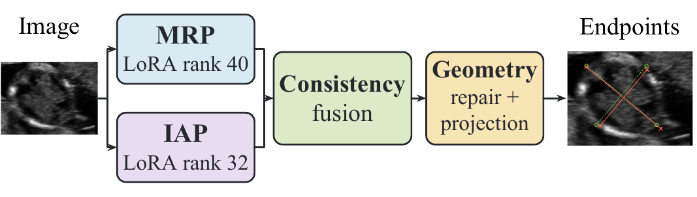
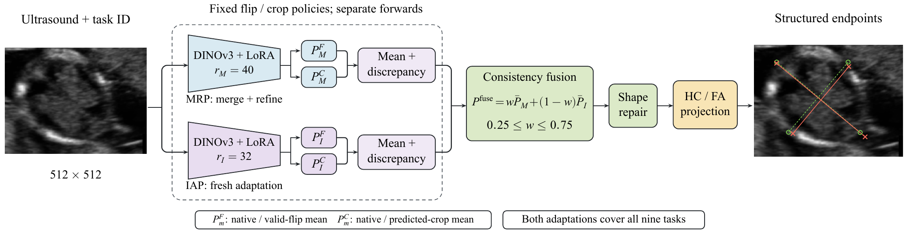
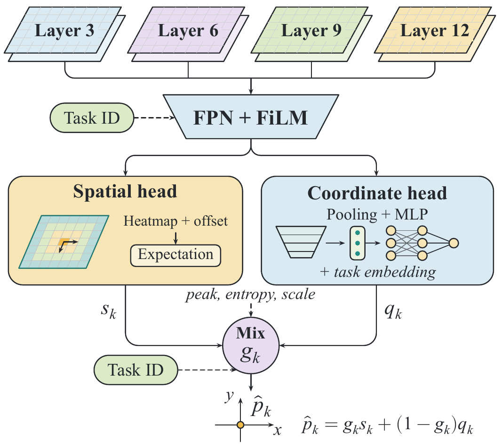
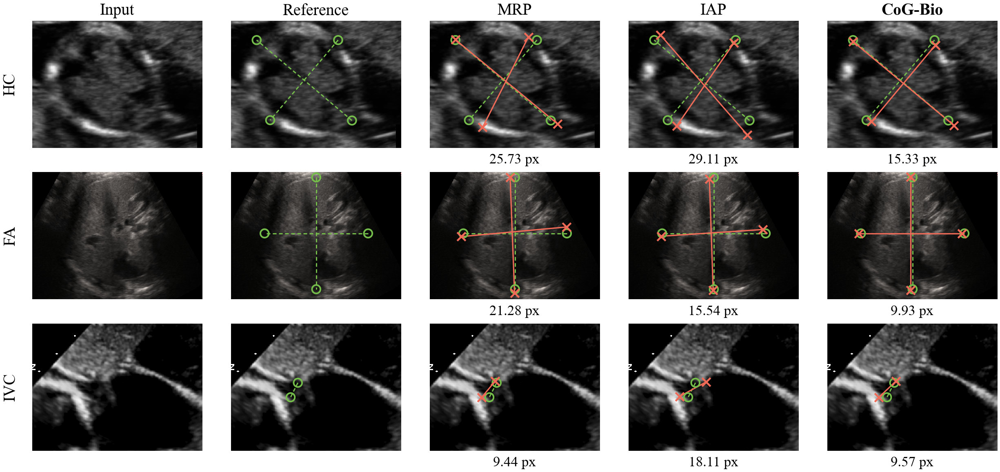
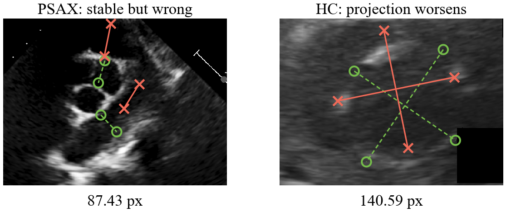

<a id="top"></a>

<div align="center">

<h1>🩺 CoG-Bio</h1>

<p><strong>Consistency + Geometry for Structured Ultrasound Biometry</strong></p>
<p><strong>Co</strong>nsistency · <strong>G</strong>eometry · <strong>Bio</strong>metry</p>

<p>
  <a href="#installation"></a>
  <a href="requirements.txt"></a>
  <a href="#highlights"></a>
  <a href="configs/landmark_schema.yaml"></a>
</p>

<p>
  <a href="https://rudykon.github.io/CoG-Bio/">🖼️ Poster</a> ·
  <a href="#method">🧭 Method</a> ·
  <a href="#results">📊 Results</a> ·
  <a href="#qualitative">🖼️ Examples</a> ·
  <a href="#installation">🚀 Installation</a> ·
  <a href="#inference">🎯 Inference</a> ·
  <a href="#training">🏋️ Training</a> ·
  <a href="docs/data_format.md">📋 Data format</a> ·
  <a href="VERIFICATION.md">✅ Verification</a> ·
  <a href="README_zh.md">🌐 中文</a>
</p>

</div>

---

Implementation of CoG-Bio for structured ultrasound biometry. The final
23.67 px configuration consists of a frozen DINOv3 encoder, merge-refined predictor (MRP),
independently adapted predictor (IAP), fixed flip/crop views, bounded consistency
fusion, conditional cardiac shape repair and HC/FA caliper projection.

This repository contains source code, configurations, tests, and selected figures
and aggregate result tables from the manuscript. The manuscript, its LaTeX
sources, raw medical datasets and neural checkpoints are not included.

<p align="center">
  <a href="assets/readme/overview.png"></a>
</p>

<a id="highlights"></a>

## ✨ Highlights

| 🧠 Shared foundation | 🔀 Complementary predictors | 📐 Structured geometry |
|---|---|---|
| Frozen DINOv3 features with low-rank adaptation across nine tasks. | MRP and IAP combine distinct training histories with bounded, image-level consistency weights. | Training-fitted shape repair and caliper projection enforce the annotation geometry. |

<a id="method"></a>

## 🧭 Method

<p align="center">
  <a href="assets/readme/framework.png"></a>
</p>

**Fixed views → consistency weighting → geometric correction.** Each predictor
covers all nine tasks. Its flip/crop disagreement sets one bounded model weight
shared by every landmark in the image. Reference endpoints are circles;
predictions are crosses. Select any figure to view it at full resolution.

<details>
<summary><strong>🧠 Task-conditioned prediction head</strong></summary>

<p align="center">
  <a href="assets/readme/prediction_head.png"></a>
</p>

Each predictor has its own spatial and coordinate branches. Decoder-feature
scale, heatmap peak and entropy, and the task embedding condition the learned
gate. This gate combines the branches within a predictor, before model fusion.
Dashed arrows denote conditioning; the icons are schematic.

</details>

<a id="results"></a>

## 📊 Evaluation snapshot

| Measure | Result |
|---|---:|
| Ultrasound tasks | **9** |
| Released benchmark images | **1,281** |
| Task-macro MRE in original image pixels | **23.67 px** |
| Saved-prediction replay: maximum coordinate difference | **0 px** |

### Benchmark comparison · 1,281 images

All nine rows are DINOv3-based configurations of this system with different
training histories and inference budgets. MRE is measured in original image
pixels; the macro score weights the nine tasks equally. Lower is better.
“Models” counts checkpoints; forwards are the maximum per image.

| Configuration | Models | Max. forwards / image | Macro MRE ↓ (px) |
|---|---:|---:|---:|
| Initial fit | 1 | 1 | 24.56 |
| Layout refinement | 1 | 1 | 24.59 |
| Parameter merge | 1 | 1 | 24.43 |
| Merge + flip | 1 | 2 | 24.23 |
| MRP | 1 | 4 | 24.20 |
| IAP | 1 | 4 | 25.35 |
| Equal mean | 2 | 8 | 24.07 |
| Consistency fusion | 2 | 8 | 23.90 |
| **CoG-Bio** | 2 | 8 | **23.67** |

<details>
<summary><strong>📋 Full nine-task results</strong></summary>

| Configuration | A4C | AOP | FA | FUGC | HC | IVC | PLAX | PSAX | Femur | Macro ↓ |
|---|---:|---:|---:|---:|---:|---:|---:|---:|---:|---:|
| Initial fit | 29.15 | 23.22 | 27.60 | 14.59 | 20.13 | **24.53** | 23.55 | 42.91 | 15.38 | 24.56 |
| Layout refinement | 29.22 | **21.82** | 28.55 | **14.35** | 19.38 | 25.83 | 23.35 | **42.69** | 16.15 | 24.59 |
| Parameter merge | 29.06 | 22.35 | 27.93 | 14.42 | 19.60 | 24.88 | 23.39 | 42.74 | 15.54 | 24.43 |
| Merge + flip | 29.06 | 22.35 | 26.96 | 14.42 | **19.09** | 24.88 | 23.39 | 42.74 | 15.20 | 24.23 |
| MRP | 28.86 | 22.33 | 26.12 | 14.74 | 20.00 | 24.86 | 23.30 | 42.72 | 14.89 | 24.20 |
| IAP | 26.25 | 25.96 | 25.92 | 15.02 | 19.66 | 34.63 | **21.14** | 46.23 | **13.33** | 25.35 |
| Equal mean | 26.18 | 23.52 | 25.37 | 14.54 | 19.56 | 28.77 | 21.29 | 43.56 | 13.88 | 24.07 |
| Consistency fusion | **26.05** | 23.63 | 25.34 | 14.53 | 19.55 | 27.40 | 21.26 | 43.87 | 13.46 | 23.90 |
| **CoG-Bio** | **26.05** | 23.63 | **23.58** | 14.53 | 19.22 | 27.40 | 21.26 | 43.87 | 13.46 | **23.67** |

Bold values mark column minima, including ties. CoG-Bio is the final selected
configuration.

</details>

### Module ablation · 2,384 development images

C: image-level consistency weighting; S: conditional shape repair;
P: HC/FA projection. ✓ enables a module; — omits it. MRP and IAP are individual
predictors; all fusion variants use the same saved predictions from both models.

| Configuration | C | S | P | MRE ↓ (px) |
|---|:---:|:---:|:---:|---:|
| MRP | — | — | — | 27.7569 |
| IAP | — | — | — | 26.3605 |
| Equal mean | — | — | — | 26.3952 |
| Consistency | ✓ | — | — | 26.1648 |
| + shape | ✓ | ✓ | — | 25.9050 |
| + projection | ✓ | — | ✓ | 25.9465 |
| **CoG-Bio** | ✓ | ✓ | ✓ | **25.6867** |

The development and benchmark tables report separate evaluation sets.

See [reproduction notes](docs/reproduction.md) for the fixed configuration and
[verification](VERIFICATION.md) for numerical checks and their scope.

<a id="qualitative"></a>

## 🖼️ Qualitative results

<p align="center">
  <a href="assets/readme/qualitative.png"></a>
</p>

**Real development images with existing annotations and saved predictions.**
Green circles and dashed lines show reference calipers; red crosses and solid
lines show predictions. Values are per-image MRE in original pixels, with the
same crop used for every method. HC and FA are high-projection-gain examples;
IVC illustrates a shift in fusion weight. These selected examples explain the
mechanism rather than the frequency of improvement.

<details>
<summary><strong>🔎 Failure examples from the same study</strong></summary>

<p align="center">
  <a href="assets/readme/failures.png"></a>
</p>

The largest-error PSAX development case remains inaccurate despite low view
disagreement (87.43 px MRE). In the displayed HC case, projection increases MRE
from 137.91 to 140.59 px. Geometric validity alone does not establish accurate
landmark localization.

</details>

<a id="installation"></a>

## 🚀 Installation

Use Python 3.11 or 3.12 in a dedicated environment. Install the pinned dependencies:

```bash
python -m pip install -r requirements.txt
python -m pip install -r requirements-dev.txt
python -m pytest -q
```

Run the commands below from this directory. Scripts resolve their default
configuration files relative to their own location. No command downloads images,
models or code automatically. CUDA inference uses bfloat16 encoder features and
float32 geometric heads. `--device cpu --workers 0` supports diagnostic runs.

<a id="assets"></a>

## 📦 Required external assets

1. Obtain the challenge images and annotations through the organizers. Preserve
   the corrected FA endpoint ordering and the released image dimensions.
2. Download `model.safetensors` from the pinned
   `timm/vit_base_patch16_dinov3.lvd1689m` model repository, revision
   `c6a5fb7d12bbd3cf3b0079253141c3332aaed7da`, under its applicable terms.
   Place it in an encoder directory, then run:

   ```bash
   python scripts/prepare_encoder.py --encoder /path/to/encoder
   ```

3. Supply the learned MRP and IAP checkpoints as `mrp.pth` and `iap.pth` in one
   weights directory, or train them with the commands below. Each checkpoint
   contains `model_config` and `state_dict`; the frozen encoder is loaded
   separately. The package contains the fitted aggregate shape prior but no
   neural checkpoints, dataset images, individual labels or case predictions.

<a id="inference"></a>

## 🎯 Inference and evaluation

```bash
python scripts/predict.py \
  --manifest /path/to/images.csv --image-root /path/to/image_root \
  --encoder /path/to/encoder --weights /path/to/adaptations \
  --output runs/prediction --device cuda:0

python scripts/evaluate.py \
  --predictions runs/prediction/predictions.json \
  --labels /path/to/labels.csv --output runs/score.json
```

Inference reads only the image manifest. It writes four view predictions, final
`predictions.json` and a receipt. Evaluation reads labels separately and computes
the mean over valid landmarks within each image, the mean over images within
each task, then the equally weighted mean over the nine tasks. The units are
original image pixels. Missing, duplicate or malformed predictions are errors.

`--verify-paper-checksums` checks whether the supplied checkpoints are the exact
recorded paper artifacts. Omit it for newly trained checkpoints. The encoder
artifact is always verified. Output directories must be new.

To apply only the fusion and geometric stages to saved view predictions:

```bash
python scripts/fuse.py \
  --views runs/prediction/mrp_flip_mean.json runs/prediction/mrp_crop_mean.json \
          runs/prediction/iap_flip_mean.json runs/prediction/iap_crop_mean.json \
  --manifest /path/to/images.csv --output runs/fused.json
```

<a id="training"></a>

## 🏋️ Training the final configuration

The following stages use the fixed lengths selected for the final training
partition. Supply the same ordered, identity-excluded training manifest to each
stage. `--exclude` can additionally check sample and identity-group separation
from an excluded manifest. The exact paper score depends on the original split
and learned artifacts; generating a random split does not reproduce it.

<details>
<summary><strong>Expand the complete training sequence: MRP parents → merge → refinement, IAP and shape prior</strong></summary>

```bash
COGBIO_TRAIN=/path/to/train.csv
COGBIO_DATA=/path/to/image_root
COGBIO_ENCODER=/path/to/encoder

# Rank-8 parent: warmup and continuation.
python scripts/train.py --config configs/train_mrp_base_final.json \
  --manifest "$COGBIO_TRAIN" --image-root "$COGBIO_DATA" \
  --encoder "$COGBIO_ENCODER" --output runs/mrp_base

# Grow the parent to rank 32 and refine its spatial layout.
python scripts/train.py --config configs/train_mrp_layout_final.json \
  --manifest "$COGBIO_TRAIN" --image-root "$COGBIO_DATA" \
  --encoder "$COGBIO_ENCODER" --initial runs/mrp_base/selected_checkpoint.pth \
  --output runs/mrp_layout

# The merged rank-40 residual is the mean of the two parent residuals.
python scripts/merge_adapters.py \
  --first runs/mrp_base/selected_checkpoint.pth \
  --second runs/mrp_layout/selected_checkpoint.pth --output runs/mrp_merged.pth

python scripts/train.py --config configs/train_mrp_final.json \
  --manifest "$COGBIO_TRAIN" --image-root "$COGBIO_DATA" \
  --encoder "$COGBIO_ENCODER" --initial runs/mrp_merged.pth --output runs/mrp

# IAP starts independently from the same frozen encoder.
python scripts/train.py --config configs/train_iap_final.json \
  --manifest "$COGBIO_TRAIN" --image-root "$COGBIO_DATA" \
  --encoder "$COGBIO_ENCODER" --output runs/iap

python scripts/fit_shape_prior.py --manifest "$COGBIO_TRAIN" \
  --output runs/shape_prior.json
```

</details>

Copy the final two selected checkpoints to your weights directory using the
names in `configs/inference.json`. When retraining on a different partition,
pass the training-fitted prior with `predict.py --prior runs/shape_prior.json`.
Never fit the prior or select training lengths with evaluation annotations.

The development MRP/IAP recipes require a separate `--validation` manifest.
MRP development additionally requires an appropriate development-only merged
parent; the final-fit parent must not be reused for development evaluation.
Final recipes refuse a validation manifest and save the predetermined state.

<a id="source"></a>

## 🗂️ Source organization

| Path | Purpose |
|---|---|
| `clingeo/model.py`, `precision.py`, `models/` | Frozen encoder, LoRA and task-conditioned heads |
| `clingeo/data/`, `images.py` | Image loading, augmentation and coordinate mapping |
| `clingeo/training/`, `losses/` | Stage training, losses, adapter growth/merge, EMA |
| `clingeo/views.py`, `fusion.py` | Fixed views and image-level model weighting |
| `clingeo/shape.py`, `projection.py` | Training-fitted repair and caliper geometry |
| `clingeo/inference.py`, `evaluation.py`, `io.py` | Portable inference, metrics and validation |
| `configs/` | Selected recipes, task schema and aggregate shape prior |
| `scripts/`, `tests/` | Command-line entry points and synthetic regression tests |
| `assets/readme/` | Selected rendered manuscript figures used on this page |

The schema retains its original task-index order, including clinical aliases,
to load the recorded checkpoints correctly. The evaluation task list contains
the nine dataset domains, not every alias entry in the schema.

The existing `clingeo` Python import path is retained for compatibility.

## ✅ Checks and documentation

The recorded local suite has **96 passing tests**, with **1 CUDA-only test skipped**
when CUDA is unavailable. Run `make test` or `make coverage` to check your setup.

| Resource | Contents |
|---|---|
| 📋 [Data format](docs/data_format.md) | Image manifests, labels and endpoint records |
| 🔁 [Reproduction notes](docs/reproduction.md) | Training stages, fusion settings and coordinate conventions |
| 🔎 [Verification report](VERIFICATION.md) | Test coverage, forward parity and saved-prediction replay |
| 📚 [External components](THIRD_PARTY.md) | Pretrained encoder, dataset and third-party terms |

<p align="center"><a href="#top">⬆ Back to top</a></p>
