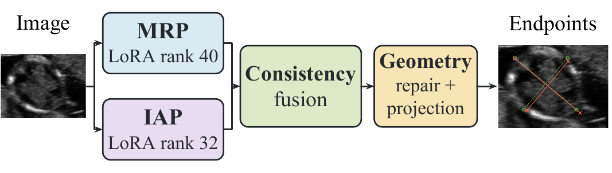
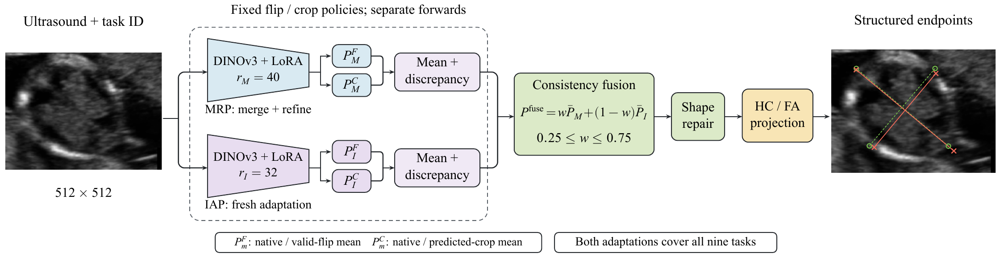
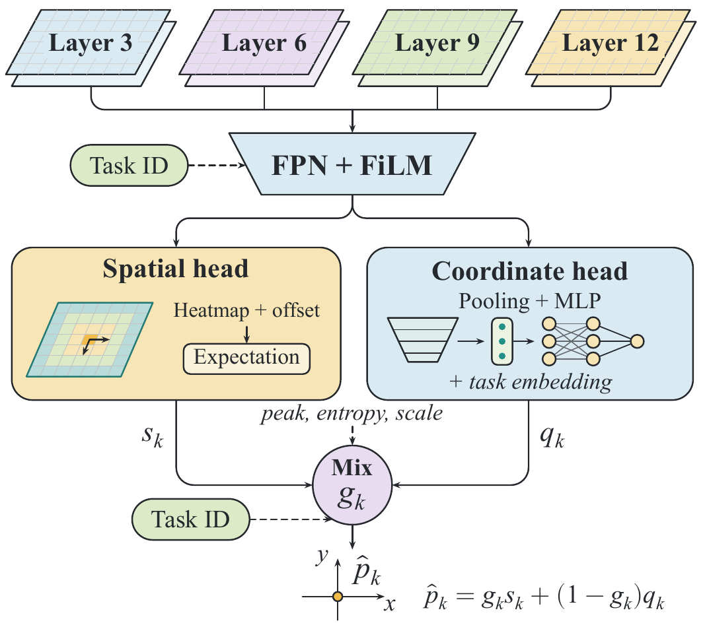
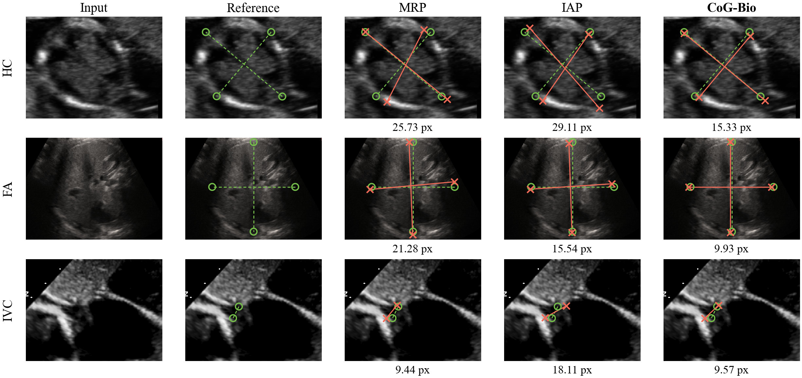
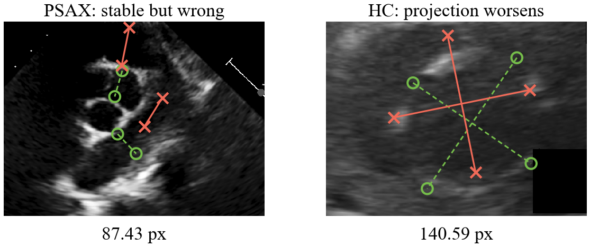

<h1>🩺 CoG-Bio</h1>

<strong>一致性与几何约束驱动的结构化超声测量</strong>

  
  
  

  <a href="https://rudykon.github.io/CoG-Bio/">🌐 项目主页</a> ·
  <a href="README.md">🌐 English</a> ·
  <a href="#method">🧭 方法</a> ·
  <a href="#results">📊 结果</a> ·
  <a href="#qualitative">🖼️ 效果</a> ·
  <a href="README.md#installation">🚀 安装</a> ·
  <a href="README.md#inference">🎯 推理</a> ·
  <a href="README.md#training">🏋️ 训练</a> ·
  <a href="docs/data_format.md">📋 数据格式</a>

---

CoG-Bio 取自 Consistency（一致性）、Geometry（几何）和 Biometry（生物测量）。
为兼容已有脚本，Python 导入路径仍为 `clingeo`。

本目录对应论文最终 **23.67 px** 方案，包含模型、训练、推理、双模型融合、
几何校正、评估、配置和测试。全部命令及训练顺序见 [README.md](README.md)。

  

## ✨ 方法概览

- 🧠 **MRP**：秩 8 母模型 → 秩 32 空间布局适配 → 合并为秩 40 → MRE 微调。
- 🔀 **IAP**：从同一冻结 DINOv3 编码器独立初始化并训练，LoRA 秩为 32。
- 📐 **推理**：每个模型使用固定翻转与裁剪策略，按图像级视图一致性融合，再进行条件形状修复和卡尺投影。
- 🧩 **合并**：`A = [A1; A2]`、`B = 0.5 * [B1, B2]`，因此残差表示两个母模型更新的均值。

## 🧭 完整方法

  

每个预测器均覆盖九项任务。固定翻转与裁剪视图之间的差异决定图像级融合权重，
同一图像的所有端点共享该权重，之后依次执行几何校正。圆圈与叉号分别表示
参考端点和预测端点。点击图片可查看原始分辨率。

<strong>🧠 展开任务条件化预测头</strong>

  

每个预测器分别具有空间分支和坐标分支，利用热图峰值、熵、预测尺度及任务嵌入
进行门控混合。该门控发生在预测器内部，随后才进行双模型融合。虚线表示条件信号，
图标为结构示意。

## 📊 结果与验证

| 项目 | 结果 |
|---|---:|
| 超声测量任务 | **9 项** |
| 已发布基准图像 | **1,281 张** |
| 原图像素下的任务宏平均 MRE | **23.67 px** |
| 已保存预测重放的最大坐标差异 | **0 px** |

### 基准集对比 · 1,281 张图像

以下九行均为本系统基于 DINOv3 的不同配置，训练历史和推理预算不同。
MRE 的单位为原图像素，宏平均对九项任务等权，数值越低越好。
模型数指检查点数，前向次数指每张图像的最大次数。

| 配置 | 模型数 | 最大前向次数 / 图像 | 宏平均 MRE ↓（px） |
|---|---:|---:|---:|
| Initial fit | 1 | 1 | 24.56 |
| Layout refinement | 1 | 1 | 24.59 |
| Parameter merge | 1 | 1 | 24.43 |
| Merge + flip | 1 | 2 | 24.23 |
| MRP | 1 | 4 | 24.20 |
| IAP | 1 | 4 | 25.35 |
| Equal mean | 2 | 8 | 24.07 |
| Consistency fusion | 2 | 8 | 23.90 |
| **CoG-Bio** | 2 | 8 | **23.67** |

<strong>📋 展开全部九项任务的结果</strong>

| 配置 | A4C | AOP | FA | FUGC | HC | IVC | PLAX | PSAX | Femur | 宏平均 ↓ |
|---|---:|---:|---:|---:|---:|---:|---:|---:|---:|---:|
| Initial fit | 29.15 | 23.22 | 27.60 | 14.59 | 20.13 | **24.53** | 23.55 | 42.91 | 15.38 | 24.56 |
| Layout refinement | 29.22 | **21.82** | 28.55 | **14.35** | 19.38 | 25.83 | 23.35 | **42.69** | 16.15 | 24.59 |
| Parameter merge | 29.06 | 22.35 | 27.93 | 14.42 | 19.60 | 24.88 | 23.39 | 42.74 | 15.54 | 24.43 |
| Merge + flip | 29.06 | 22.35 | 26.96 | 14.42 | **19.09** | 24.88 | 23.39 | 42.74 | 15.20 | 24.23 |
| MRP | 28.86 | 22.33 | 26.12 | 14.74 | 20.00 | 24.86 | 23.30 | 42.72 | 14.89 | 24.20 |
| IAP | 26.25 | 25.96 | 25.92 | 15.02 | 19.66 | 34.63 | **21.14** | 46.23 | **13.33** | 25.35 |
| Equal mean | 26.18 | 23.52 | 25.37 | 14.54 | 19.56 | 28.77 | 21.29 | 43.56 | 13.88 | 24.07 |
| Consistency fusion | **26.05** | 23.63 | 25.34 | 14.53 | 19.55 | 27.40 | 21.26 | 43.87 | 13.46 | 23.90 |
| **CoG-Bio** | **26.05** | 23.63 | **23.58** | 14.53 | 19.22 | 27.40 | 21.26 | 43.87 | 13.46 | **23.67** |

加粗表示各列最小值，包含并列情况。CoG-Bio 为最终选定配置。

### 模块消融 · 2,384 张开发集图像

C：图像级一致性加权；S：条件形状修复；P：HC/FA 投影。
✓ 表示启用，— 表示未启用。MRP 和 IAP 行对应单独的预测器；其他融合配置使用同一组双模型预测。

| 配置 | C | S | P | MRE ↓（px） |
|---|:---:|:---:|:---:|---:|
| MRP | — | — | — | 27.7569 |
| IAP | — | — | — | 26.3605 |
| Equal mean | — | — | — | 26.3952 |
| Consistency | ✓ | — | — | 26.1648 |
| + shape | ✓ | ✓ | — | 25.9050 |
| + projection | ✓ | — | ✓ | 25.9465 |
| **CoG-Bio** | ✓ | ✓ | ✓ | **25.6867** |

开发集消融与基准集对比来自不同评价集，分别展示。

记录的本地测试结果为 **96 项通过**，另有 **1 项 CUDA 测试因环境无 GPU 跳过**。
完整验证范围见 [验证说明](VERIFICATION.md)，训练阶段与推理设置见 [复现说明](docs/reproduction.md)。

## 🖼️ 真实超声效果对比

  

绿色圆圈和虚线表示参考卡尺，红色叉号和实线表示预测。数值为原图像素下的逐图 MRE，
同一病例的各方法使用相同裁剪。HC 和 FA 为投影收益较高的示例，IVC 用于展示融合权重的变化。
这些经过选择的示例用于解释机制，不表示改善发生的频率。

<strong>🔎 展开同一研究中的失败案例</strong>

  

PSAX 开发集中误差最大的病例，其视图分歧较低，但最终 MRE 仍为 87.43 px。
右侧 HC 病例的 MRE 在投影后从 137.91 增至 140.59 px。
几何关系有效并不意味着关键点定位一定准确。

## 🚀 开始使用

建议使用 Python 3.11/3.12。先安装 `requirements.txt`，再准备本地 DINOv3
编码器与两个适配检查点。数据格式见 [data_format.md](docs/data_format.md)。
推理入口为 `scripts/predict.py`，评估入口为 `scripts/evaluate.py`。

## 📦 仓库内容

本包不携带原始数据、逐例标签、逐例预测或神经网络权重；保留训练得到的汇总形状先验。
本仓库收录用于 README 展示的选定论文图形与汇总结果表，不包含论文正文、附录或 LaTeX 源文件。
验证包括原实现与整理后实现的
数值一致性、合成数据训练和推理测试；没有重新执行完整 GPU 训练。

本仓库仅提供代码与运行说明；没有另行授予开源许可证，第三方组件适用其原有许可。
